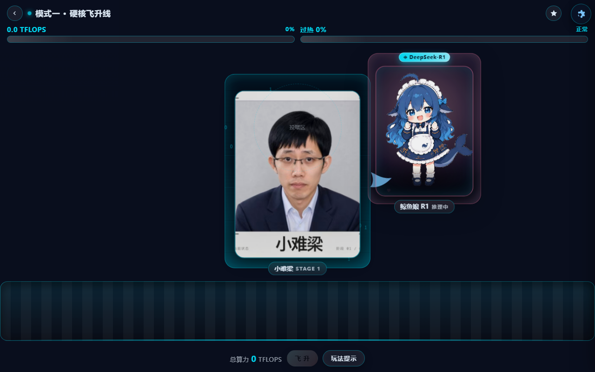
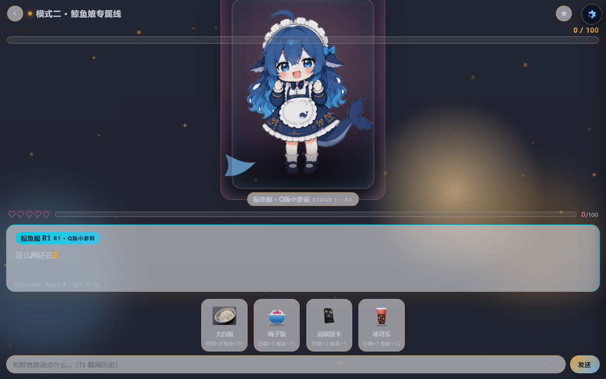

# 大肥鱼养成计划

<div align="center">

**一个单文件、零依赖、可离线运行的网页养成小游戏。**

[](./LICENSE)
[](./CHANGELOG.md)
[](#项目简介)
[](https://hsk13039707168.github.io/big-fat-fish-raising/)

**[🌐 在线试玩](https://hsk13039707168.github.io/big-fat-fish-raising/)** · [下载单文件版](#快速开始) · [功能特性](#功能特性) · [配置说明](#配置说明) · [常见问题](#常见问题) · [参与贡献](#参与贡献)

</div>

---

## 目录

- [项目简介](#项目简介)
- [功能特性](#功能特性)
- [快速开始](#快速开始)
- [使用方法](#使用方法)
- [项目结构](#项目结构)
- [配置说明](#配置说明)
- [构建单文件版](#构建单文件版)
- [浏览器与设备支持](#浏览器与设备支持)
- [常见问题](#常见问题)
- [参与贡献](#参与贡献)
- [行为准则](#行为准则)
- [许可证与免责声明](#许可证与免责声明)

---

## 项目简介

《大肥鱼养成计划》是一个用**原生 HTML + CSS + JavaScript** 写的养成类网页小游戏，全部代码、样式与图片资源可以打包进**一个 HTML 文件**，不依赖任何框架、构建工具、后端服务或网络请求。

它有两种玩法：

- **模式一 · 算力投喂**：传送带不断送出芯片与算力卡，把它们拖到鲸鱼娘嘴边投喂，累积算力推动梁文峰经历**五个阶段**的进化；同时要小心过热宕机、Bug 与 Excel 的扣分。
- **模式二 · 鲸鱼娘 GalGame**：喂食、摸头、摸肚子、对话、散步，经营**好感度**与**饱食度**两条数值，解锁三阶段换装演出与隐藏结局。

> **一句话**：下载一个 `.html` 文件，双击就能玩，断网也能玩。

### 截图

| 模式一 · 算力投喂 | 模式二 · 鲸鱼娘 GalGame |
| :---: | :---: |
|  |  |

---

## 功能特性

### 模式一 · 投喂与五阶段进化

| 特性 | 说明 |
| --- | --- |
| 传送带 | DOM 对象池复用（上限 8 个），速度随阶段递增 80 → 200 px/s |
| 拖拽投喂 | 统一 Pointer 事件，手机触屏与鼠标通用；`lerp` 平滑跟随 + 残影 + 命中粒子 |
| 芯片映射 | 9 种芯片 / 算力卡，算力值 10 → 70，稀有道具带金色呼吸光 |
| 连击 | 3 秒内 3 / 5 / 8 连击触发 `Combo x3 / x5 / x8`，x5 进入 5 秒超频双倍 |
| 过热系统 | 过热累积到 100 触发宕机，3 秒后自动恢复；液冷管可降温 |
| 五阶段进化 | 小难梁 → 牢梁 → 梁圣 → 梁神 → 梁祖（机械飞升），算力阈值 200 / 520 / 1100 / 2400 / ∞ |
| 父女互动 | 悬浮鲸鱼娘会眨眼、跳跃欢呼、说台词；稀有道具触发「爸爸好强！」 |
| 特殊形态 | 超频形态（梁嬉皮）、OOM 重启形态（梁子） |

### 模式二 · GalGame 养成

| 特性 | 说明 |
| --- | --- |
| 对话系统 | 打字机效果（35ms/字），点击跳过，台词队列，说话人标签按阶段着色 |
| 好感度 | 0–100，喂食 / 摸头 / 关键词彩蛋均可增减，30 / 60 / 90 有里程碑台词 |
| 饱食度 | 0–100，每 10 秒自然下降；吃撑会进度条抖动并禁止喂食 |
| 触摸互动 | 头部 / 腹部独立 hitbox，长按 2 秒触发特殊反应，连点 5 次有彩蛋 |
| 换装进化 | 好感度满 100 触发三阶段换装演出（R1 → V4 → AGI） |
| 散步 | 饱食度 > 80 解锁，3 秒摇摆动画后消化 |
| 隐藏结局 | 连续 3 次吃撑 → 胖海豹坏结局，可重新开始并保留好感度 |

### 通用能力

- **音效**：Web Audio 实时合成（10 种音效），无需任何音频文件；首次交互自动解锁 AudioContext
- **存档**：`localStorage` 结构化存档（`SAVE_DATA v1.0`），自动保存 + **导出 / 导入 / 重置**；隐私模式下自动降级为"不可存档但可玩"
- **成就**：25 项成就，解锁时 toast 提示并写入存档
- **移动端**：`viewport` 锁缩放、`touch-action: none`、`overscroll-behavior: none`，按钮 ≥ 44×44px，`<480px` 改为底部抽屉式设置面板
- **性能**：单一 `requestAnimationFrame` 主循环驱动全部逻辑；低性能设备自动降低粒子上限；`prefers-reduced-motion` 下禁用非必要动画
- **立绘处理**：`ImageProcessor` 用 Canvas 做白底去底与柔光蒙版；画布被污染时静默降级为 CSS 滤镜，绝不白屏、绝不报错

---

## 快速开始

### 方式零：在线试玩（最快）

打开 **<https://hsk13039707168.github.io/big-fat-fish-raising/>** —— 无需下载，手机也能直接玩。

### 方式一：直接玩（推荐，零门槛）

1. 到 [Releases](../../releases) 下载最新版本的 `big-fat-fish-raising-vX.Y.Z.html`
   （GitHub 会剔除附件名中的非 ASCII 字符，所以下载到的是英文名，文件内容就是中文名那一份）
2. 双击打开即可 —— **不需要联网，不需要 `assets/` 文件夹**

> 单文件版约 **11.8 MB**（26 张素材全部内嵌为 base64）。

### 方式二：从源码运行

```bash
git clone https://github.com/hsk13039707168/big-fat-fish-raising.git
cd big-fat-fish-raising

# 任选一种本地服务器（推荐，避免个别浏览器对 file:// 的限制）
python -m http.server 8123        # Python 3
npx serve .                       # Node.js
```

然后浏览器打开 `http://127.0.0.1:8123/大肥鱼养成计划.html`。

> 源码版必须让 `大肥鱼养成计划.html` 与 `assets/` 处于同一目录，图片用的是相对路径。

---

## 使用方法

| 操作 | 模式一 | 模式二 |
| --- | --- | --- |
| 投喂 | 把传送带上的芯片**拖到鲸鱼娘头部判定圈**松手 | 点击底部食物按钮 |
| 互动 | — | 点击立绘**头部 / 腹部**，长按 2 秒有额外反应 |
| 对话 | — | 点击对话框：打字中立即显示完整句，显示完进入下一句 |
| 菜单 | 右上角齿轮：音效 / 粒子 / 调试 / 存档 / 成就 | 同 |

**快捷键**（键盘）

| 键 | 作用 | 键 | 作用 |
| --- | --- | --- | --- |
| `1` / `2` | 切换模式一 / 模式二 | `M` | 静音开关 |
| `S` | 打开设置面板 | `D` | 调试模式（FPS / 判定圈 / 数值） |
| `ESC` | 关闭弹层 | `d s a g i` | 依次输入触发彩蛋 |

完整玩法与素材替换说明见 [`docs/运行与替换素材说明.md`](docs/运行与替换素材说明.md)。

---

## 项目结构

```
big-fat-fish-raising/
├─ 大肥鱼养成计划.html        # 游戏源码（HTML + CSS + JS 全部内嵌，约 264 KB）
├─ assets/                    # 26 个游戏素材（ASCII 文件名，避免中文路径编码问题）
├─ 素材包/                    # 原始素材备份（中文文件名，程序不直接引用）
├─ tools/
│  └─ bundle.py               # 单文件打包脚本：把 assets/ 内嵌进 HTML
├─ docs/
│  ├─ 运行与替换素材说明.md     # 玩法、配置、素材替换、历代改动详解
│  └─ prompts/                # 各版本的需求 / 提示词文档
├─ dist/                      # 构建产物（单文件版，不入库，见 .gitignore）
├─ .github/                   # Issue / PR 模板
├─ CHANGELOG.md  CONTRIBUTING.md  CODE_OF_CONDUCT.md  SECURITY.md
└─ LICENSE  README.md
```

---

## 配置说明

所有可调项集中在源码顶部的**配置区**，改配置不需要动逻辑代码。

### `ASSETS` —— 素材路径

```js
const ASSETS = {
  liang: [ { img:'liang_s1.jpg', name:'小难梁' }, ... ],  // 模式一五阶立绘
  liangXipi: 'liang_xipi.jpg',   // 超频形态
  liangZi:   'liang_zi.jpg',     // OOM 重启形态
  whale: { loli, girl, lady, eat, full },
  bug:   'bug.jpg'
};
```

### `STAGES_M1 / STAGES_M2` —— 进化阶段

```js
const STAGES_M1 = [
  { s:1, liang:['liang_s1.jpg'], liangName:'小难梁', whale:'whale_loli.jpg',
    whaleName:'鲸鱼娘 R1', quota:200, speed:80, ... },
  // ... quota 设为 Infinity 表示最终阶段
];
```

新增阶段只需往数组里追加一个对象，UI 与数值会自动适配。

### `ChipMap` —— 芯片映射（严格对应素材文件名）

| id | 名称 | 算力 | | id | 名称 | 算力 |
| --- | --- | --- | --- | --- | --- | --- |
| `chip_a100` | 英伟达 A100 | 10 | | `card_ascend910` | 昇腾 910 | 42 |
| `chip_h100` | 英伟达 H100 | 18 | | `card_ascend950` | 昇腾 950 | 55 |
| `chip_l40s` | 英伟达 L40S | 24 | | `card_gb200` | 英伟达 GB200 | 70 |
| `chip_h200` | 英伟达 H200 | 30 | | `cool_liquid` | 液冷管 | 10（散热 -20） |
| `chip_h800` | 英伟达 H800 | 36 | | `bug` / `excel` | Bug / Excel | -20 / -12 |

### 其它常用配置

| 对象 | 作用 |
| --- | --- |
| `ITEMS` | 道具表：`{ id, name, icon, value, weight, rare, heat }`，按 `weight` 权重随机刷新 |
| `TUNE` | 手感参数：拖拽 lerp 系数、粒子上限 `MAX_PARTICLES`、连击窗口等 |
| `SOUNDS` | 音效开关（Web Audio 合成，无需文件） |
| `BASE_PATH` / `FALLBACK_DIRS` | 素材搜索目录顺序：`./images/` → `./assets/` → `./素材包/…` |

### 素材尺寸建议

| 类型 | 建议尺寸 | 格式 |
| --- | --- | --- |
| 角色立绘 | 768×1024 或 1024×1024 | JPG / PNG |
| 道具图标 | 256×256 | 透明底 PNG |

替换素材最简单的方式：**保持文件名不变直接覆盖 `assets/` 里的同名文件，代码零改动**，然后重新打包（见下节）。

---

## 构建单文件版

```bash
python tools/bundle.py                        # 输出 dist/大肥鱼养成计划_单文件版.html
python tools/bundle.py -o dist/我的游戏.html    # 指定输出路径
```

脚本做三件事：

1. 把页面里所有静态 `src="assets/xxx"` 换成 `data:image/...;base64,...`
2. 在 `<head>` 注入 `window.EMBEDDED = { 文件名: dataURI }` 映射表
3. 给 `AssetLoader.candidates()` 打补丁：运行时换图（进化 / 表情 / 道具）优先查内嵌表

产物自检：外部资源引用 **0** 处，注入脚本通过 `node --check` 语法校验。

> 提示：素材统一用 base64 而非内联 SVG 文本 —— SVG 里的换行符会破坏 `<script>` 字符串字面量。

---

## 浏览器与设备支持

| 环境 | 支持情况 |
| --- | --- |
| Chrome / Edge / Firefox / Safari（近两年版本） | ✅ 完整支持 |
| Windows / macOS / Linux 桌面 | ✅ |
| Android Chrome、iOS Safari | ✅ 竖屏适配，触屏拖拽 |
| 微信 / QQ 内置浏览器 | ⚠️ 部分容器无法加载本地资源，**建议用系统浏览器** |
| IE | ❌ 不支持 |

已知限制：

- 源码版在 `file://` 下打开时，浏览器会污染 Canvas，鲸鱼娘白底只能走 CSS 滤镜兜底；**单文件版使用 `data:` 图片不会污染画布**，去底效果反而更好。
- iOS Safari 若长期不访问会清理网站数据，存档可能丢失 —— 请善用设置面板里的**导出存档**。

---

## 常见问题

<details>
<summary><b>Q1：手机上打开只有文字没有图片？</b></summary>

多半是只把 HTML 传到了手机、没带 `assets/` 文件夹。请直接下载 **Release 里的单文件版**（图片已内嵌），它不依赖任何外部文件。
</details>

<details>
<summary><b>Q2：为什么推荐用本地服务器而不是双击？</b></summary>

源码版双击也能玩，但 `file://` 协议下浏览器禁止读取画布像素，鲸鱼娘的白底去底会降级为 CSS 滤镜。起一个本地服务器（`python -m http.server`）即可获得完整效果 —— 单文件版不受此限制。
</details>

<details>
<summary><b>Q3：存档存在哪里？能迁移吗？</b></summary>

存在浏览器 `localStorage`（键名见 `SaveManager`）。设置面板支持**导出为 JSON 文本 → 在另一台设备导入**。隐私模式下不可存档，但游戏照常运行。
</details>

<details>
<summary><b>Q4：题库 / 立绘想换成自己的素材，要改代码吗？</b></summary>

不用。把新图按同名覆盖进 `assets/`，再跑一次 `python tools/bundle.py` 即可。新增阶段则往 `STAGES_M1` / `STAGES_M2` 追加对象。
</details>

<details>
<summary><b>Q5：单文件版为什么有 11.8 MB？</b></summary>

26 张素材以 base64 内嵌，体积约膨胀 33%。换来的是"一个文件走天下"。源码版（264 KB + `assets/` 6.7 MB）适合开发与二次分发。
</details>

<details>
<summary><b>Q6：可以商用 / 上架应用商店吗？</b></summary>

代码 MIT 许可，但**素材形象涉及第三方商标与真人肖像**，请勿商用（见下方免责声明）。
</details>

---

## 参与贡献

欢迎提交 Issue 与 Pull Request！请先阅读：

- [`CONTRIBUTING.md`](./CONTRIBUTING.md) —— 开发流程、代码规范、提交信息约定
- [`CODE_OF_CONDUCT.md`](./CODE_OF_CONDUCT.md) —— 行为准则
- [`SECURITY.md`](./SECURITY.md) —— 安全漏洞报告方式

提交 Bug 请使用 [Bug 报告模板](.github/ISSUE_TEMPLATE/bug_report.yml)，功能建议请使用 [需求模板](.github/ISSUE_TEMPLATE/feature_request.yml)。

```bash
# 开发流程
git checkout -b feat/你的功能
# 修改后用本地服务器验证：python -m http.server 8123
python tools/bundle.py      # 确认单文件版仍能正常构建
git commit -m "feat: 简要描述改动"
```

---

## 行为准则

本项目采用 Contributor Covenant 风格的行为准则，详见 [`CODE_OF_CONDUCT.md`](./CODE_OF_CONDUCT.md)。简而言之：**友善、尊重、就事论事**。

---

## 许可证与免责声明

- **代码**：[MIT License](./LICENSE)，可自由使用、修改、分发（需保留版权声明）。
- **素材**：`assets/` 与 `素材包/` 中的图片形象涉及第三方商标与真人肖像，**不在 MIT 授权范围内**，仅作个人学习与非商业演示用途（详见 [`assets/NOTICE.md`](assets/NOTICE.md)）。若要公开展示或商用，请自行替换为拥有合法授权的素材。
- 本项目为**个人练习性质的同人 / 恶搞作品**，与文中出现的任何企业、产品或个人均无关联，亦不代表其立场。

---

<div align="center">

如果这个项目让你笑了，欢迎点个 ⭐ Star。

</div>
